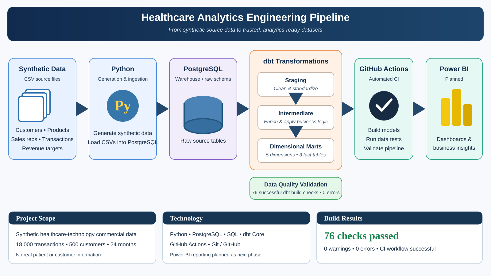

# Healthcare Analytics Engineering Pipeline

An end-to-end analytics engineering project demonstrating how raw business data can be transformed into reliable, analytics-ready datasets using Python, PostgreSQL, dbt, and GitHub Actions.

The project simulates a healthcare technology company's commercial operations, including customer activity, product sales, sales representative performance, and regional revenue targets. All datasets are synthetically generated and contain no real patient or customer information.

## Project Architecture



The workflow generates synthetic commercial datasets, ingests them into PostgreSQL, transforms them through dbt staging, intermediate, and dimensional mart models, and validates the build through GitHub Actions. Power BI reporting is planned as a subsequent phase.

## Technology Stack

| Technology | Purpose |
|---|---|
| Python | Synthetic data generation and ingestion |
| PostgreSQL | Relational data warehouse |
| SQL | Data transformation and modeling |
| dbt Core | Modular transformations and data quality testing |
| GitHub Actions | Automated CI pipeline |
| Power BI | Planned business intelligence reporting |
| Git / GitHub | Version control and project management |

## Data Sources

The pipeline generates five synthetic datasets:

| Dataset | Records | Description |
|---|---:|---|
| Customers | 500 | Customer attributes, regions, and account segments |
| Products | 5 | Product catalog and pricing |
| Sales Representatives | 30 | Sales representative information |
| Transactions | 18,000 | Transaction-level sales and revenue |
| Revenue Targets | 120 | Monthly revenue targets by region |

The generated transaction data covers January 2024 through December 2025.

## Data Transformation

dbt organizes the transformation process into three layers.

### 1. Staging

Five staging models standardize raw source data through:
- Column selection and renaming
- Data type casting
- String cleaning
- Initial data quality tests

### 2. Intermediate

Three intermediate models introduce business logic and combine related datasets:

- `int_transactions_enriched`: Enriches transactions with customer, product, and sales representative attributes.
- `int_monthly_revenue_by_region`: Aggregates monthly revenue, transaction counts, active customers, and regional revenue targets.
- `int_customer_monthly_activity`: Calculates customer-level monthly purchasing activity.

### 3. Marts

The final analytical layer contains eight dimensional models.

**Dimensions**
- `dim_customer`
- `dim_product`
- `dim_sales_rep`
- `dim_region`
- `dim_date`

**Fact Tables**
- `fact_revenue` — transaction-level revenue.
- `fact_sales_targets` — regional monthly revenue targets.
- `fact_customer_activity` — customer-level monthly purchasing activity.

The dimensional model is designed to support reporting across customers, products, sales representatives, regions, dates, revenue, and customer activity.

## Data Quality and Testing

Data quality is enforced through dbt schema tests and custom SQL tests.

The project includes:
- Primary key uniqueness and not-null checks
- Foreign key relationship validation
- Customer-month grain validation
- Regional monthly sales target grain validation
- Revenue reconciliation between intermediate and final fact models

**Latest local build results:**
- 76 passing dbt checks
- 0 warnings
- 0 errors
- 0 skipped tests

## Automated CI Pipeline

GitHub Actions automatically executes the pipeline when changes are pushed to the `main` branch or a pull request targets `main`.

The workflow:
1. Checks out the repository.
2. Sets up Python.
3. Installs project dependencies.
4. Generates synthetic datasets.
5. Loads raw data into PostgreSQL.
6. Creates the dbt profile.
7. Executes `dbt build`, including model materialization and data quality tests.

The workflow also supports manual execution through GitHub Actions.

## Repository Structure

```text
healthcare-analytics-engineering-pipeline/
│
├── .github/
│   └── workflows/
│       └── dbt-build.yml
│
├── data/
│   ├── raw/
│   └── sample/
│
├── dbt_project/
│   └── healthcare_analytics/
│       ├── models/
│       │   ├── staging/
│       │   ├── intermediate/
│       │   └── marts/
│       └── tests/
│
├── ingestion/
│   ├── generate_data.py
│   ├── load_raw_data.py
│   └── test_connection.py
│
├── docs/
├── powerbi/
├── requirements.txt
└── README.md
```

## Running the Project Locally

### Prerequisites

- Python 3.12
- PostgreSQL
- Git

### 1. Clone the repository

```bash
git clone https://github.com/sifrank/healthcare-analytics-engineering-pipeline.git
cd healthcare-analytics-engineering-pipeline
```

### 2. Create and activate a virtual environment

```bash
py -3.12 -m venv .venv
```

Windows PowerShell:

```powershell
.\.venv\Scripts\Activate.ps1
```

### 3. Install dependencies

```bash
pip install -r requirements.txt
```

### 4. Configure environment variables

Create a `.env` file in the project root:

```env
DB_HOST=localhost
DB_PORT=5432
DB_NAME=healthcare_analytics
DB_USER=postgres
DB_PASSWORD=your_local_password
```

Create a PostgreSQL database named `healthcare_analytics` before running ingestion.

### 5. Generate and load data

```bash
python ingestion/generate_data.py
python ingestion/load_raw_data.py
```

### 6. Configure dbt

Create a dbt profile at `~/.dbt/profiles.yml` using your local PostgreSQL credentials.

Configure the profile with:
- Profile name: `healthcare_analytics`
- Target: `dev`
- Database: `healthcare_analytics`
- Schema: `analytics`

### 7. Build the dbt project

From the dbt project directory:

```bash
cd dbt_project/healthcare_analytics
dbt debug
dbt build
```

## Future Development

- Complete an interactive Power BI dashboard connected to the dimensional marts.
- Add dbt documentation and model lineage.
- Expand data quality coverage and source freshness monitoring.
- Explore incremental models and more advanced orchestration.

---

**Author:** [Samantha Frank](https://www.linkedin.com/in/samanthairisfrank/)

**Repository:** [GitHub – Healthcare Analytics Engineering Pipeline](https://github.com/sifrank/healthcare-analytics-engineering-pipeline)
